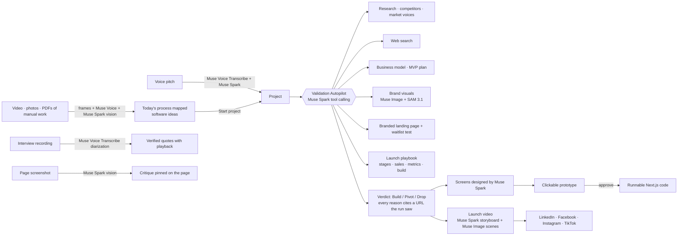

# Startum × Meta — Meta Global AI Developer Hackathon

**Track:** Startup · **Problem statement:** Build for Your World

Startum helps first-time founders find out whether a SaaS idea is worth building before they spend months on it:
real market research, real customer quotes, competitor prices, plans, a brand and a landing page to test demand.
It existed before the hackathon. **During the hackathon we moved it onto Meta's models and built five new
capabilities that only became possible with them.** Everything below was built between Oct 26 and Nov 4, 2026.

- Pre-hackathon state: tag [`pre-hackathon-baseline`](../../tree/pre-hackathon-baseline) (commit `fb035ea`)
- Everything built during the hackathon: [`pre-hackathon-baseline...main`](../../compare/pre-hackathon-baseline...main) — every commit is prefixed `Hackathon:`
- Live product: [startum.website](https://startum.website)
- Open source under the [MIT License](LICENSE)

## The five Meta models, and what each one does

| Meta model | What it does in Startum | Features | Code |
|---|---|---|---|
| **Muse Spark** (`muse-spark-1.3`) | The brain. Runs the Validation Autopilot agent with ten tools, sees video frames, photos and screenshots, designs screens and writes code, and returns structured JSON through native `json_schema` output | Autopilot, Traditional → Innovative, Page review, Design → prototype → code, Launch playbook, launch-video storyboards, art direction for brand visuals, Copilot, and every pre-existing AI feature | [`agent.ts`](src/server/jobs/autopilot/agent.ts), [`run.ts`](src/server/ai/run.ts), [`providers.ts`](src/server/ai/providers.ts) |
| **Muse Spark Open** (open weights, on Baseten) | The fast reader. Pulls facts and verbatim quotes out of research sources, competitor pages, forum threads and Reddit / Hacker News posts 3–6× faster than the hosted model, and translates the interface on the fly | Research, Competitors, Market voices, Gold Mine pain mining, French / Spanish / Arabic interface | `openWeightsRoute` in [`providers.ts`](src/server/ai/providers.ts), [`translate.ts`](src/server/services/translate.ts) |
| **Muse Image** | The designer. Draws the logo mark, landing-page hero, one ad per platform and the 9:16 scenes of launch videos, in the brand's colours | Brand visuals, Launch videos | [`image.ts`](src/server/ai/image.ts), [`brand-visuals.ts`](src/server/services/brand-visuals.ts) |
| **SAM 3.1** | The cutter. Segments the logo so it sits on a transparent background, then reused on landing pages and video end cards | Brand visuals, Launch videos | [`image.ts`](src/server/ai/image.ts) |
| **Muse Voice Transcribe** | The listener. Transcribes customer interviews with speaker labels (diarization), spoken pitches, and the narration in videos of manual work | Voice interviews, Pitch it out loud, Traditional → Innovative | [`voice.ts`](src/server/ai/voice.ts), [`services/voice.ts`](src/server/services/voice.ts) |

Before the hackathon Startum ran on other providers' models. In the live product every AI call now goes to Meta's models: the hosted
Meta Model API for Muse Spark, Muse Image, SAM 3.1 and Muse Voice, and Muse Spark Open on Baseten.

## Built during the hackathon vs. before

**Built during the hackathon (Oct 26 – Nov 4, 2026)**, all in commits prefixed `Hackathon:`:

- Moving every AI feature onto Meta's models, with native structured output and the open-weights route
- Validation Autopilot (agent with ten tools, verified citations, Build / Pivot / Drop)
- Voice interviews with diarization and quote playback; Pitch it out loud
- Brand visuals (Muse Image + SAM 3.1)
- Page review (vision)
- Launch playbook
- Design → clickable prototype → runnable Next.js code (replacing the earlier design flow)
- Launch videos and posts for TikTok, Instagram, Facebook and LinkedIn
- Traditional → Innovative, with enterprise mode
- Copilot ideas → "Create project" / "Validate with Autopilot"
- French, Spanish and Arabic (right-to-left), the top bar with search, notifications and dark mode

New pages added during the hackathon: Traditional → Innovative, Autopilot, Launch playbook, Page review, Launch
videos, Prototype and Code (compare the tag with `main`).

**Already in Startum before the hackathon** (tag `pre-hackathon-baseline`), now running on Meta's models but not
built during the event: Discover Ideas, Gold Mine, Research, Competitors, Market voices, the Validation Lab
(interviews from text, waitlists, landing-page tests), Brand Kit, Plan, Marketing Studio with ad tests, the AI
Copilot chat, and the Idea Marketplace. The demo video shows some of these to explain the full journey; the
features above are the hackathon work.

## What we built, and which Meta model powers it

| # | Feature | Meta models | Where |
|---|---|---|---|
| 1 | **Validation Autopilot** — an agent that validates an idea end to end and decides Build / Pivot / Drop | Muse Spark (tool calling) | Project → Autopilot |
| 2 | **Voice interviews** — upload a customer interview, get who-said-what and quotes you can play back | Muse Voice Transcribe (diarization) + Muse Spark | Lab → interview experiment |
| 3 | **Pitch it out loud** — speak your idea, get a project and an Autopilot run | Muse Voice Transcribe + Muse Spark | Projects → New |
| 4 | **Brand visuals** — research-grounded logo, landing hero and channel ads | Muse Spark (art director) + Muse Image + SAM 3.1 | Project → Brand |
| 5 | **Page review** — screenshot critique of your landing page or a competitor's, pinned on the image | Muse Spark (vision) | Project → Page review |
| 6 | **Startum on Muse Spark** — every existing AI feature (research, plans, marketing, copilot, Gold Mine) | Muse Spark (native JSON Schema output) | everywhere |
| 7 | **Open-weights route** — research, competitor, forum and pain extraction run on Muse Spark Open on Baseten, 3–6× faster | Muse Spark Open | `OPEN_MODEL_*` env |
| 8 | **Copilot ideas → projects** — every idea the Copilot suggests gets "Create project" and "Validate with Autopilot" buttons | Muse Spark | AI Copilot → Find SaaS ideas |
| 9 | **Launch playbook** — idea to market in one plan: 6 stages with exit gates, founder-led sales playbook, SaaS metrics with code-computed revenue maths, retention, build sprints and AI-coding prompts | Muse Spark (structured output) | Project → Launch playbook |
| 10 | **Design → clickable prototype → code** — Muse Spark designs every screen, links them into a Figma-style prototype, and after approval writes a runnable Next.js app | Muse Spark | Project → Design |
| 11 | **Launch videos for organic social** — a vertical captioned video and a native post for TikTok, Instagram Reels, Facebook and LinkedIn; post from Startum or download | Muse Spark (storyboard + posts) + Muse Image (scenes) | Project → Launch videos |
| 12 | **Traditional → Innovative** — upload a video, photos or PDFs of work done by hand; Muse Spark maps today's process with evidence and proposes the SaaS, automation or system that replaces it. An enterprise mode designs complex systems for oil & gas, banks, hospitals and more | Muse Spark (vision + structured output) + Muse Voice Transcribe | Traditional → Innovative |
| 13 | **Startum in French, Spanish and Arabic** — the interface is translated on the fly and every AI result is written in the user's language, with right-to-left Arabic; plus a top bar with search, notifications and dark mode | Muse Spark Open (interface translation) + Muse Spark (results in the user's language) | Top bar → language |

### 1. Validation Autopilot (agentic)

A Muse Spark agent with ten tools: `read_project`, `run_market_validation` (Startum's research pipeline,
competitor scan and forum "market voices"), `read_evidence`, `web_search`, `generate_business_model`,
`generate_mvp_plan`, `design_brand`, `create_landing_page`, `create_launch_playbook` and `submit_verdict`. It decides what to do, narrates
each step in one sentence on a live timeline, and stops when it hands in a verdict.

**Verifiable by construction.** Every reason in the verdict must cite URLs, and the server keeps a reason only if
that URL appeared in a tool result during the run (`verifyCitations`). A verdict with fewer than two verified
reasons is rejected back to the agent to fix. Weak ideas don't get plans, a brand or a landing page.

Measured runs (all on `muse-spark-1.3`):

| Idea | What the agent did | Verdict | Time | AI cost |
|---|---|---|---|---|
| Waitlist backfill for physio clinics (had research) | evidence → 2 targeted searches | **Pivot** 70%, 6 cited reasons, 0 dropped | 30 s | $0.05 |
| Custom-order desk for bakeries (new idea) | full research (3 jobs) → evidence → pricing search | **Pivot** 70%, 5 cited reasons | 3 min 21 s | $0.27 incl. research |
| Daycare compliance tracker (new idea) | research → evidence → 2 searches → business model → MVP plan → brand + 5 visuals → branded landing page | **Build** 67%, 8 cited reasons, 0 dropped | 4 min 55 s | $0.47 incl. everything |

Code: [`src/server/jobs/autopilot/agent.ts`](src/server/jobs/autopilot/agent.ts), [`callAgent` in `src/server/ai/run.ts`](src/server/ai/run.ts), [`src/components/autopilot/autopilot-panel.tsx`](src/components/autopilot/autopilot-panel.tsx)

### 2. Voice interviews

Customer interviews are the core of validation, and founders record them. Upload the recording (MP3, M4A, WAV,
WebM, up to 100 MB): ffmpeg converts it to 16 kHz WAV in 9-minute segments (the API takes 10 minutes per
request), Muse Voice Transcribe runs in `DIARIZATION` mode with the product's and competitors' names as
keyword hints, and the existing interview analysis reads the speaker-labelled transcript. Quotes that don't appear
verbatim in the transcript are discarded; each kept quote links to the turn it was said in and **plays the audio
from that moment**. Measured: a 3 min 11 s recording → 8 timed turns in 35 s.

Code: [`src/server/ai/voice.ts`](src/server/ai/voice.ts), [`src/server/services/voice.ts`](src/server/services/voice.ts), [`src/components/lab/interview-tools.tsx`](src/components/lab/interview-tools.tsx)

### 3. Pitch it out loud

Record up to three minutes in the browser. Muse Voice Transcribe writes it down, Muse Spark turns it into a project
(name + structured description, nothing added) and pulls out the founder's own doubt ("would they pay?") as the
Autopilot's focus. Measured: a 53 s pitch → project in 16 s.

Code: [`src/components/voice/voice-pitch.tsx`](src/components/voice/voice-pitch.tsx), `pitchToProject` in [`src/server/services/voice.ts`](src/server/services/voice.ts)

### 4. Brand visuals (creative)

Muse Spark acts as **art director**: it reads the research, real customer quotes and the Brand Kit and writes a
brief per image, citing the finding each one is based on. Muse Image renders a logo mark, a landing hero and one ad
per ad platform in parallel. **SAM 3.1 cuts the logo out** onto a transparent background (masks decoded with
Meta's `@meta-sam/parser`, applied as alpha with sharp). Ad headlines come from the customers' own words and are
drawn on by the app, so spelling and brand colours are exact. Landing pages can show the hero; the Autopilot uses it
automatically. Measured: 5 visuals in ~30 s for ~$0.06.

Code: [`src/server/ai/image.ts`](src/server/ai/image.ts), [`src/server/services/brand-visuals.ts`](src/server/services/brand-visuals.ts), [`src/components/brand-kit/brand-visuals.tsx`](src/components/brand-kit/brand-visuals.tsx)

### 5. Page review (vision)

Upload a screenshot. **My landing page:** 5-second test, score, issues judged against the research and pinned on the
screenshot as numbered boxes, plus a rewrite in the customers' words. **A competitor's page:** plans and prices read
off the page (never guessed), weak spots pinned on it, and where you can win given your research and pricing.
In testing, the pins landed on the exact elements (e.g. the CTA button, a pricing tier, a cookie banner hiding the
fees section).

Code: [`src/server/services/page-review.ts`](src/server/services/page-review.ts), [`src/components/page-review/page-review-panel.tsx`](src/components/page-review/page-review-panel.tsx)

### 6. Startum on Muse Spark

- Meta Model API as the provider (`AI_BASE_URL=https://api.meta.ai/v1`, `muse-spark-1.3`), with **native
  `json_schema` structured output** for api.meta.ai: our MVP-plan schema failed 2 of 3 times as prompt-JSON and
  passed 3 of 3 with constrained decoding. Other gateways keep a validate-and-retry fallback.
- Pain mining now works when Reddit blocks direct page reads (reads the search provider's page text instead,
  quotes still checked verbatim): 1 thread read → 9, 0 quotes → 12.
- Full A-to-Z test, `pnpm e2e:ai`: **36 of 37 steps pass** for $0.83 per complete journey (the one failure is a
  third-party keyword API account awaiting verification).

### 7. Open-weights route

`OPEN_MODEL_BASE_URL`, `OPEN_MODEL_API_KEY`, `OPEN_MODEL` (default `meta-models/muse-spark-open-1026`) and
`OPEN_MODEL_OPERATIONS` send the listed operations (e.g. `pain_extract,voice_extract`) to Muse Spark Open on any
OpenAI-compatible host while everything else stays on the Meta Model API. Usage logs record which model served each call.

**Running on Baseten.** We send Startum's four high-volume extraction steps to Muse Spark Open on Baseten
(`inference.baseten.co`): reading research sources, competitor pages, forum threads (market voices) and Reddit / Hacker
News threads (Gold Mine pain mining). Muse Spark Open always reasons, so every call sends `reasoning_effort: low`
(it halved reasoning tokens in our tests). Baseten follows a JSON Schema only in strict mode (non-strict, the model
renamed keys), so these calls use strict mode whenever every field of the schema is required, and fall back to the
schema-in-prompt path with validation and one retry otherwise. Quotes are still kept only if they appear word for
word in the source.

Measured in the full A-to-Z run (`pnpm e2e:ai`, 36 of 37 steps pass, same as on the hosted API):

| Step | Muse Spark (hosted API), avg | Muse Spark Open on Baseten |
|---|---|---|
| Research source extraction | 33.4 s | 9.4 s |
| Competitor extraction | 56.4 s | 9.8 s |
| Market voices extraction | 23.5 s | 4.7 s |
| Pain mining extraction | 19.5 s | 5.9 s, 11 verified quotes in 4 pain clusters |

Code: `openWeightsRoute` in [`src/server/ai/providers.ts`](src/server/ai/providers.ts), `strictCompatible` in [`src/server/ai/run.ts`](src/server/ai/run.ts)

### 8. Copilot ideas → projects

Ask the AI Copilot for ideas ("Find SaaS ideas", or any tool) and each idea comes back in a fixed format: name,
one-liner, customer, problem, solution. Under the reply, each idea gets **Create project** and **Validate with
Autopilot** buttons. The project is built from the saved reply on the server, never from text sent by the browser.
Autopilot opens with the question already filled in ("Would independent groomers with 50–200 repeat clients pay for
Due-Date Texter?"), so a founder goes from a chat answer to a researched Build / Pivot / Drop verdict in two clicks.

Code: [`src/lib/copilot-ideas.ts`](src/lib/copilot-ideas.ts), `projectFromCopilotIdea` in [`src/server/services/copilot.ts`](src/server/services/copilot.ts), [`src/components/copilot/copilot-chat.tsx`](src/components/copilot/copilot-chat.tsx)

### 9. Launch playbook (idea to market)

One plan that takes an idea all the way to paying customers, built on everything Startum knows about the project:
research, customer quotes, competitors, the business model, the MVP plan and the marketing plan.

- **Six stages with gates:** validate → build → pre-launch → launch → first 10 customers → grow to $10k MRR. Each has a
  timeframe sized to the founder's hours, measurable "move on when" criteria, tasks with hour estimates, and a link
  to the Startum feature that does each task.
- **Sales playbook:** the sales motion chosen from price and buyer (self-serve, founder-led or sales-assisted), the
  ideal customer with buying triggers and disqualifiers, prospecting with a daily routine, a multi-touch outreach
  sequence, discovery questions about past behaviour, a demo flow, objections, a founding-customer offer and pipeline
  stages. Objections marked as customer quotes are checked against the collected quotes; unmatched ones are relabelled
  as hypotheses.
- **SaaS metrics:** north star, activation moment, a five-stage funnel with targets marked as assumptions, and a
  weekly dashboard. **The revenue maths is computed by code, not the model:** lifetime value, the maximum cost to win a
  customer, and customers needed for $1k / $5k / $10k MRR, from the business model's main tier.
- **Retention, pricing tactics and a build plan:** week-by-week sprints with a definition of done, a launch
  infrastructure checklist, and prompts ready to paste into an AI coding tool. Downloadable as Markdown.
- The Autopilot writes it automatically (`create_launch_playbook`) for ideas it decides to build.

Measured: about 60 s and $0.06 per playbook on `muse-spark-1.3`.

Code: [`src/lib/validation/launch-playbook.ts`](src/lib/validation/launch-playbook.ts), [`src/server/services/launch-playbook.ts`](src/server/services/launch-playbook.ts), [`src/server/ai/prompts/launch-playbook.ts`](src/server/ai/prompts/launch-playbook.ts)

### 10. Design → clickable prototype → code

After validation, the founder sees the product before building it, then gets the code.

- **Design (Muse Spark as product designer):** each screen is written as a complete Tailwind HTML document from the
  project's research, MVP plan, Brand Kit and customers' own words. Every screen uses the same brand tokens
  (`bg-primary`, `text-ink`, `font-heading` …) set from the Brand Kit. Marketing screens never invent traction:
  testimonials, customer counts and results are marked placeholders. Edits are plain language ("move pricing above
  the fold").
- **Clickable prototype:** buttons and links that lead to another screen carry `data-goto="<screen>"`. The prototype
  viewer shows one screen at a time at its real 1280px width, scaled to fit; clicking a hotspot switches screens,
  clicking anywhere else flashes the hotspots (like Figma's prototype mode). Screens run in an opaque-origin
  sandbox and talk to the viewer only through `postMessage`, checked against the iframe's window.
- **Approve → code:** a background job makes one structured call for the data model (entities, fields, realistic
  seed rows) and one call per screen that converts the design into a Next.js App Router page: `data-goto` becomes
  `<Link>`, lists read real rows from a JSON-file store, forms create records through server actions. The scaffold
  around the pages (Tailwind v4 theme with the same tokens, store, actions, README, PROMPT.md for Claude Code or
  Cursor, the designs and docs) is deterministic code. A page whose conversion fails twice falls back to embedding its
  approved design, so one bad page never sinks the build.
- **Change it, yourself or with Muse Spark:** every file is editable in the app; or ask in plain words ("add a
  pricing page with 3 plans and link it from the nav") and Muse Spark rewrites the files it needs. Every change is a
  new version (restore any earlier one).
- **Make sure it runs:** after every generation, AI change and manual save, the worker type-checks the whole project
  in memory with the TypeScript compiler (against declarations of exactly what the scaffold allows), plus React rules
  that compile but crash at runtime (hooks without "use client", client files reading the server store, `class=`,
  `style="…"`). If anything fails, Muse Spark fixes the files involved, up to two rounds; a round that makes things
  worse is discarded. The founder sees "Compiles: 0 problems" or each problem, clickable to the exact line.
- **Runs on StackBlitz:** we posted generated apps to StackBlitz and found Next.js 15.5 crashes in its WebContainers
  ("Expected workUnitAsyncStorage to have a store"); the scaffold pins Next.js 15.3.5, which we verified boots there
  with Tailwind, the brand and data from the store. The result can be browsed, downloaded as a zip, or run on
  StackBlitz in one click.

Measured on two projects: about 25 s and $0.03 per screen design; code for 3–4 screens in 60–90 s for $0.15–0.23.
A Muse Spark change (a new pricing page linked from the nav) took 24 s; the check takes about 3 s; fixing two
deliberate mistakes in a manual edit took 12 s in one round.
Both generated apps passed `tsc --noEmit` with zero errors and `next build` on the first try.

Code: [`src/server/design/muse.ts`](src/server/design/muse.ts), [`src/server/ai/prompts/design-screen.ts`](src/server/ai/prompts/design-screen.ts), [`src/lib/prototype.ts`](src/lib/prototype.ts), [`src/components/design/prototype-viewer.tsx`](src/components/design/prototype-viewer.tsx), [`src/server/jobs/codebase.ts`](src/server/jobs/codebase.ts), [`src/lib/codebase.ts`](src/lib/codebase.ts), [`src/server/codebase/check.ts`](src/server/codebase/check.ts), [`src/components/design/code-viewer.tsx`](src/components/design/code-viewer.tsx)

### 11. Launch videos for organic social

Organic short-form video is how most bootstrapped SaaS products get their first users. Startum makes the video and
the posts from what it already knows about the product.

- **Storyboard (Muse Spark):** pick an angle (problem → solution, in customers' own words, build in public, launch
  day). Muse Spark writes a 15–30 s, 3–6 scene vertical video: a hook in the first two seconds, captions written to be
  read on mute, a call to action, and a native post for each platform (a LinkedIn story post, a Facebook post, an
  Instagram caption, a TikTok caption, each with its own hashtags). It may not invent users, numbers or testimonials.
- **Scenes (Muse Image):** every scene is drawn in 9:16 from the storyboard, in parallel, in the brand's colours, with
  no text in the image (captions are added afterwards, crisp).
- **Render (ffmpeg in the worker):** slow Ken Burns zoom on each scene, the caption card fading in, cross-fades, and a
  branded end card with the logo (SAM 3.1 cut-out from Brand visuals), the call to action and the landing-page link.
  H.264 + silent AAC (some platforms reject videos without audio), 1080×1920, 30 fps.
- **Publish:** download the MP4 and copy each platform's post; or connect accounts and post from Startum:
  LinkedIn (video upload + post on the member's profile), Facebook Pages and Instagram Reels (one Meta login; Meta
  fetches the video from a signed, expiring link), TikTok (sent to the user's TikTok inbox to add a sound and post).
  Tokens are encrypted at rest (AES-256-GCM); the OAuth state is signed and checked. Each platform is switched on by
  its developer-app credentials.

Measured: one 18 s video (4 scenes) in 57 s for about $0.06 (storyboard $0.02, 4 scenes $0.04). The publishing
connectors are implemented against each platform's API but not yet exercised with live developer apps.

Code: [`src/server/jobs/launch-video.ts`](src/server/jobs/launch-video.ts), [`src/server/video/render.ts`](src/server/video/render.ts), [`src/server/ai/prompts/launch-video.ts`](src/server/ai/prompts/launch-video.ts), [`src/server/social/providers.ts`](src/server/social/providers.ts), [`src/components/videos/launch-videos.tsx`](src/components/videos/launch-videos.tsx)

### 12. Traditional → Innovative (vision)

Most SaaS ideas start from watching someone do a job the slow way. This section lets a client show it instead of
describing it.

- **Upload:** a video of the work being done, photos or screenshots, PDFs (procedures, forms, reports) and/or a short
  description. Up to 8 files; videos up to 100 MB.
- **Read (worker):** ffmpeg samples up to 10 frames spread over the video; Muse Voice Transcribe turns the narration
  into text; photos are normalised with sharp; PDFs are read page by page (unpdf).
- **See (Muse Spark vision):** frames, photos, PDF text and transcript go to Muse Spark in one request. It maps the
  current way of working step by step: how each step is done today, the tools, the pain, and the evidence it saw
  ("frame 7s", "photo 1", "PDF p. 3"), plus the data handled, bottlenecks, risks and what the material doesn't show.
- **Propose (Muse Spark):** 5–8 ideas, from a quick automation to a bold platform, each tied to the steps it replaces,
  with an MVP, who pays, pricing (labelled as an assumption), who else has the problem and a test for this week.
- **Enterprise mode:** pick an industry (oil & gas, banking, hospitals, logistics, telecom, public sector…), company
  size and region. Muse Spark designs 4–6 systems with architecture, data, integrations (SAP, SCADA, core banking,
  EHR), the role of AI and the human in the loop, compliance, a 60–90 day pilot, the sales cycle and the narrow wedge a
  startup could sell first. Value is stated as a hypothesis, never invented figures.
- **Start project:** any idea becomes a Startum project with a full brief, ready for research, design and testing.

Measured: a garage front-desk scan (16 s video, a one-page procedure PDF, a photo) in 44 s for about $0.055: five
steps mapped with frame and page evidence, seven ideas. An oil & gas scan (North Africa, text only) in 42 s for about
$0.034: five system ideas, from an offline field-inspection app to fibre and satellite leak detection.
The narration step reuses the interview transcriber (tested in section 2); it hasn't yet been run on a narrated scan video.

Code: [`src/server/jobs/innovation.ts`](src/server/jobs/innovation.ts), [`src/server/innovation/media.ts`](src/server/innovation/media.ts), [`src/server/ai/prompts/innovation.ts`](src/server/ai/prompts/innovation.ts), [`src/components/innovation/scan-result.tsx`](src/components/innovation/scan-result.tsx)

### 13. Startum in four languages

- **AI results in the user's language:** the language saved on the account (English, French, Spanish or Arabic) is
  added to every Muse Spark call, so research, ideas, scans, plans and copilot answers come back in it, while JSON
  keys, enum values, URLs and names stay as the app expects.
- **Interface translated by Muse Spark Open:** the sidebar and top bar have hand-written translations; the rest of
  each page is translated on the fly. The browser collects the interface text it doesn't know, the server translates
  it in batches on Meta's open-weights model (about 2.5 s for 20 strings, against about 30 s on the hosted API) and
  keeps every translation in Redis, shared by all users, so each string is translated once per language. Names and
  project titles are left as written.
- **Arabic** switches the app to right-to-left with an Arabic font.
- **Top bar:** search across pages, projects, ideas and scans (Ctrl K), notifications when research, designs,
  videos or scans finish, and a dark theme.

Code: [`src/components/app/page-translator.tsx`](src/components/app/page-translator.tsx), [`src/server/services/translate.ts`](src/server/services/translate.ts), [`src/lib/i18n.ts`](src/lib/i18n.ts), [`src/components/app/top-bar.tsx`](src/components/app/top-bar.tsx)

## How it fits together



## Cost (measured on our $150 hackathon credit)

| Action | Cost |
|---|---|
| Autopilot run on a project with research | ~$0.05 |
| Autopilot run from a bare idea to a branded landing page | ~$0.47 |
| Full journey through every Startum feature | ~$0.83 |
| 5 brand visuals (Muse Image + SAM 3.1) | ~$0.06 |
| Voice transcription | $0.003 per minute |
| One screen designed by Muse Spark | ~$0.03 |
| Approved prototype → runnable code (3–4 screens) | $0.15–0.23 |
| Launch video (storyboard, posts for 4 platforms, 4 scenes, rendered MP4) | ~$0.06 |
| Traditional → Innovative scan (video + PDF + photo, process map, 7 ideas) | ~$0.055 |
| Enterprise scan (5 system ideas with architecture and pilot) | ~$0.034 |

Total spent building and testing everything above: under $10.

## Run it

```bash
pnpm install
docker compose up -d                       # Postgres + Redis
cp .env.example .env                       # set AI_BASE_URL=https://api.meta.ai/v1, AI_API_KEY, SEARCH_API_KEY
pnpm db:migrate
pnpm dev                                   # app on :3100
pnpm worker                                # research, pain mining and Autopilot jobs (Node 22)
pnpm ai:smoke                              # 2 calls: checks the Meta Model API works
pnpm e2e:ai -- --only=autopilot --idea="Name: description"   # a full Autopilot run, trace printed live
```

Voice needs `ffmpeg` on the server (included in the Docker image).
