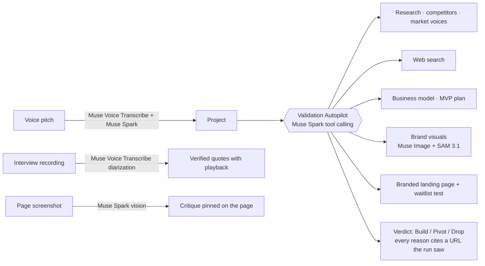

# Startum × Meta — Meta Global AI Developer Hackathon

**Track:** Startup · **Problem statement:** Build for Your World

Startum helps first-time founders find out whether a SaaS idea is worth building before they spend months on it:
real market research, real customer quotes, competitor prices, plans, a brand and a landing page to test demand.
It existed before the hackathon. **During the hackathon we moved it onto Meta's models and built five new
capabilities that only became possible with them.** Everything below was built between Oct 26 and Nov 4, 2026.

- Pre-hackathon state: tag [`pre-hackathon-baseline`](../../tree/pre-hackathon-baseline) (commit `b63f4c9`)
- Everything built during the hackathon: [`pre-hackathon-baseline...main`](../../compare/pre-hackathon-baseline...main) — every commit is prefixed `Hackathon:`

## What we built, and which Meta model powers it

| # | Feature | Meta models | Where |
|---|---|---|---|
| 1 | **Validation Autopilot** — an agent that validates an idea end to end and decides Build / Pivot / Drop | Muse Spark (tool calling) | Project → Autopilot |
| 2 | **Voice interviews** — upload a customer interview, get who-said-what and quotes you can play back | Muse Voice Transcribe (diarization) + Muse Spark | Lab → interview experiment |
| 3 | **Pitch it out loud** — speak your idea, get a project and an Autopilot run | Muse Voice Transcribe + Muse Spark | Projects → New |
| 4 | **Brand visuals** — research-grounded logo, landing hero and channel ads | Muse Spark (art director) + Muse Image + SAM 3.1 | Project → Brand |
| 5 | **Page review** — screenshot critique of your landing page or a competitor's, pinned on the image | Muse Spark (vision) | Project → Page review |
| 6 | **Startum on Muse Spark** — every existing AI feature (research, plans, marketing, copilot, Gold Mine) | Muse Spark (native JSON Schema output) | everywhere |
| 7 | **Open-weights route** — send chosen steps to Muse Spark Open on Baseten / Modal / vLLM | Muse Spark Open | `OPEN_MODEL_*` env |

### 1. Validation Autopilot (agentic)

A Muse Spark agent with nine tools: `read_project`, `run_market_validation` (Startum's research pipeline,
competitor scan and forum "market voices"), `read_evidence`, `web_search`, `generate_business_model`,
`generate_mvp_plan`, `design_brand`, `create_landing_page` and `submit_verdict`. It decides what to do, narrates
each step in one sentence on a live timeline, and stops when it hands in a verdict.

**Verifiable by construction.** Every reason in the verdict must cite URLs, and the server keeps a reason only if
that URL appeared in a tool result during the run (`verifyCitations`). A verdict with fewer than two verified
reasons is rejected back to the agent to fix. Weak ideas don't get plans, a brand or a landing page.

Measured runs (all on `muse-spark-1.3`):

| Idea | What the agent did | Verdict | Time | AI cost |
|---|---|---|---|---|
| Waitlist backfill for physio clinics (had research) | evidence → 2 targeted searches | **Pivot** 70%, 6 cited reasons, 0 dropped | 30 s | $0.05 |
| Custom-order desk for bakeries (new idea) | full research (3 jobs) → evidence → pricing search | **Pivot** 70%, 5 cited reasons | 3 min 21 s | $0.27 incl. research |
| Daycare compliance tracker (new idea) | research → evidence → 2 searches → business model → MVP plan → brand + 5 visuals → branded landing page | **Build** 67%, 8 cited reasons, 0 dropped | 4 min 55 s | $0.47 incl. everything |

Code: [`src/server/jobs/autopilot/agent.ts`](src/server/jobs/autopilot/agent.ts), [`callAgent` in `src/server/ai/run.ts`](src/server/ai/run.ts), [`src/components/autopilot/autopilot-panel.tsx`](src/components/autopilot/autopilot-panel.tsx)

### 2. Voice interviews

Customer interviews are the core of validation, and founders record them. Upload the recording (MP3, M4A, WAV,
WebM, up to 100 MB): ffmpeg converts it to 16 kHz WAV in 9-minute segments (the API takes 10 minutes per
request), Muse Voice Transcribe runs in `DIARIZATION` mode with the product's and competitors' names as
keyword hints, and the existing interview analysis reads the speaker-labelled transcript. Quotes that don't appear
verbatim in the transcript are discarded; each kept quote links to the turn it was said in and **plays the audio
from that moment**. Measured: a 3 min 11 s recording → 8 timed turns in 35 s.

Code: [`src/server/ai/voice.ts`](src/server/ai/voice.ts), [`src/server/services/voice.ts`](src/server/services/voice.ts), [`src/components/lab/interview-tools.tsx`](src/components/lab/interview-tools.tsx)

### 3. Pitch it out loud

Record up to three minutes in the browser. Muse Voice Transcribe writes it down, Muse Spark turns it into a project
(name + structured description, nothing added) and pulls out the founder's own doubt ("would they pay?") as the
Autopilot's focus. Measured: a 53 s pitch → project in 16 s.

Code: [`src/components/voice/voice-pitch.tsx`](src/components/voice/voice-pitch.tsx), `pitchToProject` in [`src/server/services/voice.ts`](src/server/services/voice.ts)

### 4. Brand visuals (creative)

Muse Spark acts as **art director**: it reads the research, real customer quotes and the Brand Kit and writes a
brief per image, citing the finding each one is based on. Muse Image renders a logo mark, a landing hero and one ad
per ad platform in parallel. **SAM 3.1 cuts the logo out** onto a transparent background (masks decoded with
Meta's `@meta-sam/parser`, applied as alpha with sharp). Ad headlines come from the customers' own words and are
drawn on by the app, so spelling and brand colours are exact. Landing pages can show the hero; the Autopilot uses it
automatically. Measured: 5 visuals in ~30 s for ~$0.06.

Code: [`src/server/ai/image.ts`](src/server/ai/image.ts), [`src/server/services/brand-visuals.ts`](src/server/services/brand-visuals.ts), [`src/components/brand-kit/brand-visuals.tsx`](src/components/brand-kit/brand-visuals.tsx)

### 5. Page review (vision)

Upload a screenshot. **My landing page:** 5-second test, score, issues judged against the research and pinned on the
screenshot as numbered boxes, plus a rewrite in the customers' words. **A competitor's page:** plans and prices read
off the page (never guessed), weak spots pinned on it, and where you can win given your research and pricing.
In testing, the pins landed on the exact elements (e.g. the CTA button, a pricing tier, a cookie banner hiding the
fees section).

Code: [`src/server/services/page-review.ts`](src/server/services/page-review.ts), [`src/components/page-review/page-review-panel.tsx`](src/components/page-review/page-review-panel.tsx)

### 6. Startum on Muse Spark

- Meta Model API as the provider (`AI_BASE_URL=https://api.meta.ai/v1`, `muse-spark-1.3`), with **native
  `json_schema` structured output** for api.meta.ai: our MVP-plan schema failed 2 of 3 times as prompt-JSON and
  passed 3 of 3 with constrained decoding. Other gateways keep a validate-and-retry fallback.
- Pain mining now works when Reddit blocks direct page reads (reads the search provider's page text instead,
  quotes still checked verbatim): 1 thread read → 9, 0 quotes → 12.
- Full A-to-Z test, `pnpm e2e:ai`: **36 of 37 steps pass** for $0.83 per complete journey (the one failure is a
  third-party keyword API account awaiting verification).

### 7. Open-weights route

`OPEN_MODEL_BASE_URL`, `OPEN_MODEL_API_KEY`, `OPEN_MODEL` (default `meta-models/muse-spark-open-1026`) and
`OPEN_MODEL_OPERATIONS` send the listed operations (e.g. `pain_extract,voice_extract`) to Muse Spark Open on any
OpenAI-compatible host while everything else stays on the Meta Model API. Usage logs record which model served each call.

## How it fits together



## Cost (measured on our $150 hackathon credit)

| Action | Cost |
|---|---|
| Autopilot run on a project with research | ~$0.05 |
| Autopilot run from a bare idea to a branded landing page | ~$0.47 |
| Full journey through every Startum feature | ~$0.83 |
| 5 brand visuals (Muse Image + SAM 3.1) | ~$0.06 |
| Voice transcription | $0.003 per minute |

Total spent building and testing everything above: under $10.

## Run it

```bash
pnpm install
docker compose up -d                       # Postgres + Redis
cp .env.example .env                       # set AI_BASE_URL=https://api.meta.ai/v1, AI_API_KEY, SEARCH_API_KEY
pnpm db:migrate
pnpm dev                                   # app on :3100
pnpm worker                                # research, pain mining and Autopilot jobs (Node 22)
pnpm ai:smoke                              # 2 calls: checks the Meta Model API works
pnpm e2e:ai -- --only=autopilot --idea="Name: description"   # a full Autopilot run, trace printed live
```

Voice needs `ffmpeg` on the server (included in the Docker image).
